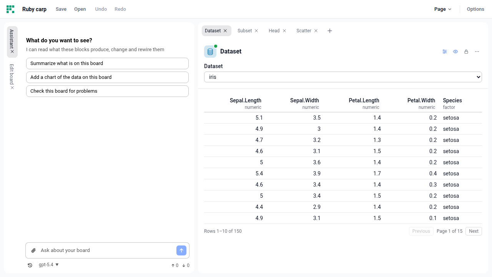

<!-- README.md is generated from README.Rmd. Please edit that file -->

```{r, include = FALSE}
knitr::opts_chunk$set(
  collapse = TRUE,
  comment = "#>",
  fig.path = "man/figures/README-",
  out.width = "100%"
)
```

# blockr.assistant

<!-- badges: start -->
[](https://lifecycle.r-lib.org/articles/stages.html#experimental)
[](https://github.com/BristolMyersSquibb/blockr.assistant/actions/workflows/ci.yaml)
[](https://app.codecov.io/gh/BristolMyersSquibb/blockr.assistant)
<!-- badges: end -->

The assistant is a plugin for [blockr](https://github.com/BristolMyersSquibb/blockr) boards.
Its model reads the board and edits it beside the user.
Each edit runs commands that blockr.core and the app's packages register, as the user's own edits do.
So the user's undo takes back an edit of the assistant's as it takes back any other.
The assistant runs its agent loop in the browser.
It calls its model from the browser too, never through R.

A deployment chooses where the calls go, how they are authenticated and which models the assistant offers, through blockr options.
It can also give the model skills and a template of its own.
A package can teach the model about what it offers, such as its block classes and its results.

## Installation

You can install the development version of blockr.assistant from [GitHub](https://github.com/) with:

``` r
# install.packages("pak")
pak::pak("BristolMyersSquibb/blockr.assistant")
```

## Example

An app script puts the assistant's plugin on its board with `new_assistant_plugin()`:

```{r example-code, code=readLines("inst/examples/populated-board/app.R"), eval=FALSE}
```



The guide, [Get started](https://bristolmyerssquibb.github.io/blockr.assistant/articles/get-started.html), says how an app offers the assistant and how a package teaches its model.
An app script written for blockr.assistant 0.1 changes as the [migration notes](https://bristolmyerssquibb.github.io/blockr.assistant/articles/migration-notes.html) say.
