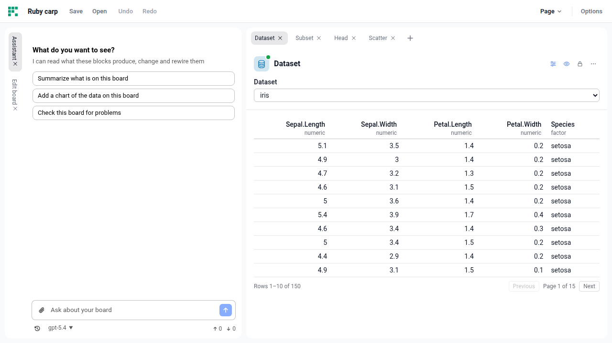

<!-- README.md is generated from README.Rmd. Please edit that file -->

# blockr.assistant

<!-- badges: start -->

[](https://lifecycle.r-lib.org/articles/stages.html#experimental)
[](https://github.com/BristolMyersSquibb/blockr.assistant/actions/workflows/ci.yaml)
[](https://app.codecov.io/gh/BristolMyersSquibb/blockr.assistant)
<!-- badges: end -->

The assistant is a plugin for
[blockr](https://github.com/BristolMyersSquibb/blockr) boards. Its model
reads the board and edits it beside the user. Each edit runs commands
that blockr.core and the app’s packages register, as the user’s own
edits do. So the user’s undo takes back an edit of the assistant’s as it
takes back any other. The assistant runs its agent loop in the browser.
It calls its model from the browser too, never through R.

A deployment chooses where the calls go, how they are authenticated and
which models the assistant offers, through blockr options. It can also
give the model skills and a template of its own. A package can teach the
model about what it offers, such as its block classes and its results.

## Installation

You can install the development version of blockr.assistant from
[GitHub](https://github.com/) with:

``` r
# install.packages("pak")
pak::pak("BristolMyersSquibb/blockr.assistant")
```

## Example

An app script puts the assistant’s plugin on its board with
`new_assistant_plugin()`:

``` r
library(blockr.core)
library(blockr.assistant)

# A small pipeline on the board before the assistant opens, so that it has
# something to read and to build on.
# The app runs under the frontend that its packages give: the dock where
# blockr.dock is installed, and core's basic frontend otherwise.
# Try:
#
# - "What is on the board?"
#   The answer comes from the board that each call sends the model, with no
#   tool call.
# - "What are the unique values of Species in the data block?"
#   The model calls inspect_results, with code such as unique(data$Species).
# - "Add a scatter plot of Sepal.Length against Petal.Length."
#   The model adds the block and links it in one edit, and reads the edit's
#   review.
# - "Change the id of the block head to top_rows."
#   Ids never change, so the model explains that it would remove the block
#   and add it again, and asks before it does.
#
# The assistant calls its model from the browser.
# A deployment says where the calls go through the assistant's blockr options.
# It sets them as environment variables, so that this script stays as it is.
# A demo on OpenAI's models sets two of them:
#
#   BLOCKR_ASSISTANT_API_KEY, the deployment's key
#   BLOCKR_ASSISTANT_MODELS, the models that it offers, such as gpt-5.4
#
# Where the deployment sets no key, the chat asks each visitor for their own.
# A deployment that sends its calls to another base URL names it in
# BLOCKR_ASSISTANT_BASE_URL.
# It names the API that the base URL speaks in BLOCKR_ASSISTANT_API, unless
# that is OpenAI's Responses API.
# An app whose visitors log in with OpenRouter sets these two:
#
#   BLOCKR_ASSISTANT_BASE_URL, OpenRouter's https://openrouter.ai/api/v1
#   BLOCKR_ASSISTANT_API, openai-completions

board <- new_board(
  blocks = c(
    data = new_dataset_block("iris"),
    filt = new_subset_block(subset = "Sepal.Length > 5"),
    head = new_head_block(n = 10L),
    plot = new_scatter_block(x = "Sepal.Length", y = "Sepal.Width")
  ),
  links = c(
    new_link("data", "filt", "data"),
    new_link("filt", "head", "data"),
    new_link("filt", "plot", "data")
  ),
  stacks = c(
    prep = new_stack(c("data", "filt"), name = "Prep"),
    display = new_stack(c("head", "plot"), name = "Display")
  ),
  plugins = list(assistant = new_assistant_plugin())
)

serve(board)
```

<figure>

<figcaption aria-hidden="true">The assistant’s panel on the left rail of
the dock, beside the blocks of a small board.</figcaption>
</figure>

The guide, [Get
started](https://bristolmyerssquibb.github.io/blockr.assistant/articles/get-started.html),
says how an app offers the assistant and how a package teaches its
model. An app script written for blockr.assistant 0.1 changes as the
[migration
notes](https://bristolmyerssquibb.github.io/blockr.assistant/articles/migration-notes.html)
say.
